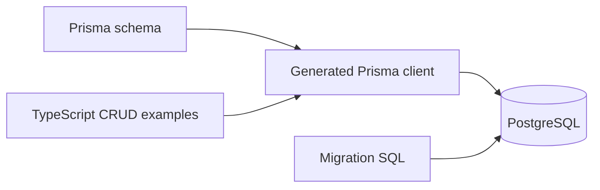

# Prisma + PostgreSQL · TypeScript CRUD

**A compact example of moving from a database schema to typed application queries.**

Prisma · PostgreSQL · TypeScript

## Purpose

This learning project demonstrates how Prisma describes a database, generates a client, and performs user operations from TypeScript. It is useful for understanding the ORM boundary without a web framework around it.

## Included examples

- A PostgreSQL schema with `User` and `Todo` models.
- A checked-in schema migration.
- User creation with selected return fields.
- User updates and deletion by unique username.

## Setup

Use Node.js/npm and a disposable PostgreSQL development database. From the source directory:

```bash
npm install
```

Set `DATABASE_URL` in a local `.env` file, then generate the client and apply the included migration:

```bash
npx prisma generate
npx prisma migrate deploy
npm run build
```

Review the sample calls in [`src/index.ts`](src/index.ts) before running:

```bash
npm start
```

The entry point immediately invokes create, update, and delete examples using sample usernames. Update/delete require those records to exist, and repeated inserts can violate the unique-username constraint. These operations are independent examples, not an ordered transaction or idempotent seed script.

## Data flow



## Source guide

| Path | Responsibility |
|---|---|
| [`prisma/schema.prisma`](prisma/schema.prisma) | Models and datasource |
| [`prisma/migrations/`](prisma/migrations/) | Schema migration history |
| [`src/index.ts`](src/index.ts) | Executable user-operation examples |
| [`tsconfig.json`](tsconfig.json) | TypeScript compiler configuration |

## Learning boundaries

`Todo.userId` is a scalar field; the schema does not declare a Prisma relation. The password field is stored directly in this demonstration, so this is not an authentication implementation. The manifest declares a Jest test command but does not include Jest in its dependencies or a test suite.

Package metadata declares the **ISC** license.
